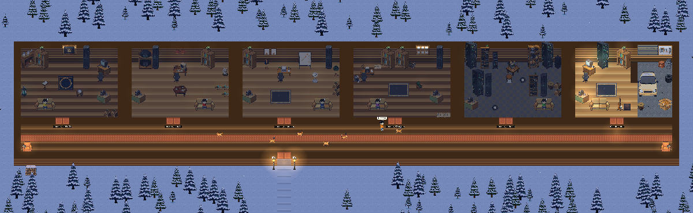
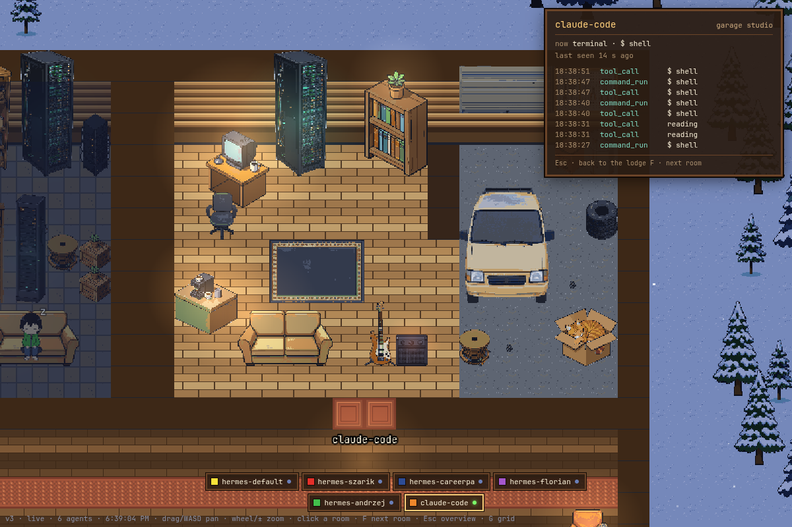
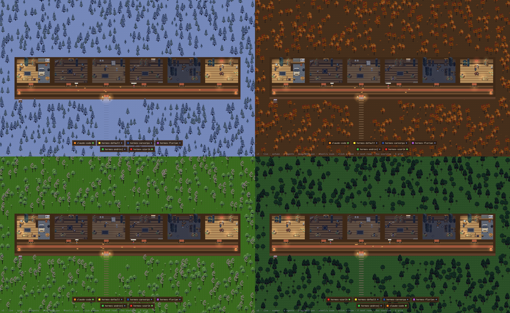

# Star Office UI — the Lodge

**A pixel-art dashboard for your AI agents.** Every agent gets its own room off one long
corridor of a log cabin in a snowy forest. Its little character walks to the desk, the
rack, the bookshelf or the garage as it edits, runs shell commands, reads or deploys, and
says what it is doing in a speech bubble. Background tasks and subagents show up as helper
bots and mini-mes in the room. Cats wander the corridor, one per agent, each with its own coat. They chase, play, groom
and now and then have a cartoon fight. Every page load picks
a season (winter, autumn, spring, summer) with its own forest and weather. Force one with
`/v3/?season=autumn`.



It is **agent-agnostic**. Anything that can send an HTTP `POST` can live in the Lodge:
Hermes, OpenChamber, OpenCode, Claude Code, Pi, or a shell script. The backend never reads
an agent's workspace, and the code holds no list of agents: each one's room look is set
when you register it.





> A maintained fork of [ringhyacinth/Star-Office-UI](https://github.com/ringhyacinth/Star-Office-UI)
> by Ring Hyacinth and Simon Lee. The v1 office and its routes are gone (v2.0.0). The
> renderer is now Phaser 4 (`frontend/v3/`), and all the art is generated by this fork.

---

## Quick start

Needs [uv](https://docs.astral.sh/uv/) (`curl -LsSf https://astral.sh/uv/install.sh | sh`).

```bash
git clone https://github.com/gulasz101/star-office-ui-fork.git
cd star-office-ui-fork
uv sync               # the locked environment from pyproject.toml + uv.lock
backend/run.sh        # http://127.0.0.1:19000, SQLite by default; loads .env if present
```

Open <http://127.0.0.1:19000/> (it redirects to `/v3/`), then push an event:

```bash
curl -X POST http://127.0.0.1:19000/events -H 'Content-Type: application/json' -d '{
  "version": 1, "agent": "my-bot", "event_type": "tool_call",
  "timestamp": "2026-10-17T12:00:00Z",
  "payload": {"tool": "Edit", "status": "ok"}
}'
```

`my-bot` gets a room. Its character walks in from the bottom of the screen and sits at
its desk.

### Controls

| Input | Does |
|---|---|
| drag / WASD | pan |
| mouse wheel, `+`/`-`, pinch | zoom (touchpad two-finger scroll pans) |
| click a room / `F` | focus a room and open its activity card / next room |
| `Esc` | back to the overview |
| `G` | tile grid overlay |

---

## Sending events

One door: **`POST /events`** with a small JSON envelope (`backend/schemas/event_v1.json`):

| Field | Notes |
|---|---|
| `version` | always `1` |
| `agent` | the agent's name. The first event from an unknown name creates its room. |
| `event_type` | open list. In use: `session_start`, `session_end`, `tool_call`, `file_edit`, `command_run`, `code_completion`, `state_change`, `background_start`, `background_end` |
| `timestamp` | ISO-8601. Offsets are honoured and normalised to UTC. |
| `payload` | type-specific, e.g. `{"tool": "Bash", "status": "ok"}` |

Answers: `201` stored, `400` with the offending field named, and when tokens are on,
`401` / `403` / `429` (see below).

**Every payload is sanitised before it is stored.** Command lines are reduced to the
program name. Home paths, URLs with credentials, tokens and free-text details are
dropped (`backend/sanitize.py`). What an agent sends is never more than what you would
put on a public screen.

How the Lodge reads events: the activity picks the zone (desk = editing, rack =
shell/ops, garage = builds and deploys, bookshelf = reading/search, couch = idle).
`background_start`/`background_end` spawn and dismiss the helpers. The mapping is plain
data in `frontend/v3/src/`.

### Ready-made reporters

You don't need to hand-wire `curl`s for these agents:

| Agent | Reporter |
|---|---|
| Claude Code | [`gulasz101/claude-code-star-office-reporter`](https://github.com/gulasz101/claude-code-star-office-reporter), a plugin. It also reports background tasks and subagents. |
| Hermes | [`gulasz101/hermes-star-office-reporter`](https://github.com/gulasz101/hermes-star-office-reporter), a plugin, one room per profile |
| OpenChamber / OpenCode | [`gulasz101/openchamber-star-office-reporter`](https://github.com/gulasz101/openchamber-star-office-reporter), also vendored at [`reporter/openchamber-star-office-reporter/`](reporter/openchamber-star-office-reporter/) |

All three take `STAR_OFFICE_URL` and `STAR_OFFICE_TOKEN`, never block the agent, and
redact on their side too.

---

## Running it in public

The design is in [`docs/public-lodge.md`](docs/public-lodge.md). The short version:

**Register each agent: a token plus a room personality.** The repo knows no agent
names. Tokens (stored as sha256 only) and each agent's room look live in the database:

```bash
uv run python backend/tokens.py register my-bot --room serverroom --hoodie 125,0.8,0.8   # prints the token once
uv run python backend/tokens.py set-room my-bot --room garage                            # change the look, no token
uv run python backend/tokens.py list                                                     # agents, rooms, token counts
```

Rooms: `garage`, `serverroom`, `factory`, `mystery`, `tokenden`, `career`, `writer`. An
agent nobody registered still gets a room: the factory floor, with a hoodie colour
derived from its name. Reporters send the token as `Authorization: Bearer <token>`. A
missing, unknown or revoked token gets `401`. A token used for another agent's name gets
`403`. Bursts get `429`.

**One image, three faces.** `SOU_MODE` decides which routes even exist in the process:

| `SOU_MODE` | Serves | Use |
|---|---|---|
| `dev` (default) | everything, tokens optional | your laptop / LAN box |
| `ingest` | `POST /events` and the private read paths. Always token-locked: with nothing registered every write gets `401`. | the private endpoint agents write to |
| `public` | `/` → `/v3/`, `/health`, `/public/feed`, `/public/agents` | the read-only page you share |

The public projection also drops `cwd`, hashes task ids and hides internal agents. The
intended deployment is `sou-ingest` on the LAN/VPN only and `sou-public` behind a tunnel,
both on the same Postgres, with a read-only role for the public one.

---

## Container image

`ghcr.io/gulasz101/star-office-ui-fork` is public, amd64, built and smoke-tested on
SQLite and Postgres by `.github/workflows/docker-image.yml` before it is pushed.

| Tag | When |
|---|---|
| `vX.Y.Z` | release tags (latest: `v2.3.0`) |
| `master-<sha7>-<unix-ts>` | every merge to master, sortable for Flux image automation |
| `latest` | the newest of the above |

```bash
docker run -d -p 127.0.0.1:19000:19000 ghcr.io/gulasz101/star-office-ui-fork:v2.3.0
```

| Variable | Default | |
|---|---|---|
| `DATABASE_URL` | SQLite at `backend/sou.db` | `postgresql+psycopg2://…` for Postgres |
| `SOU_MODE` | `dev` | `dev` / `ingest` / `public` |
| `SOU_INGEST_TOKENS` | unset | **deprecated**: `hash:agent,…` or a JSON file path. Move it into the database with `tokens.py import-env`. |
| `SOU_INGEST_RATE_LIMIT` | 20 req/s burst per token | |
| `SOU_MIGRATE` | `1` | `0` skips `alembic upgrade head` at start (the read-only public pod) |
| `STAR_BACKEND_PORT` | `19000` | |

The entrypoint migrates the schema before gunicorn starts. A failed migration stops the
container. It runs as uid 10001. Liveness: `GET /health`. For SQLite persistence, mount a
directory and set `DATABASE_URL=sqlite:////data/sou.db`. Never mount over `/app/backend`.

Upgrading from a pre-v2 database: migrations 002 (re-sanitise old payloads) and 003 (drop
the v1 roster) run automatically. Take a backup first; the runbook is
[`docs/resanitise-migration.md`](docs/resanitise-migration.md).

---

## Read API

| Endpoint | Face | Returns |
|---|---|---|
| `GET /events/recent?agent=&event_type=&since=&limit=` | dev, ingest | newest-first events (`limit` ≤ 200) |
| `GET /events/agents` | dev, ingest | every known agent with its last event |
| `GET /public/feed`, `GET /public/agents` | public | the same, through the public projection |
| `GET /health` | all | liveness |
| `GET /` | dev, public | redirects to `/v3/` |

---

## Development

```bash
uv run pytest backend/tests                       # backend
node --test "frontend/v3/tests/*.test.mjs"        # renderer logic (quote the glob)
uv run python scripts/smoke_test.py --base-url http://127.0.0.1:19000   # read-only smoke
```

- `backend/`: Flask app (`app.py`), DB layer (`db.py`, SQLite or Postgres), sanitiser,
  tokens, Alembic migrations.
- `frontend/v3/`: Phaser 4.2.1 renderer, plain ES modules, vendored (no CDN). The rooms
  are Tiled JSON built by `scripts/v3/build_rooms.py`.
- `assets/generated/`: the art, each file with a manifest (model, prompt, seed, steps).

Contributor and agent rules live in [`CLAUDE.md`](CLAUDE.md) (`AGENTS.md` is the same
file). Work is tracked on the public Itsaplan board, project `SOU`.

---

## Art and licence

- **Code: MIT** ([`LICENSE`](LICENSE)).
- **Art:** generated by this fork with FLUX.2-klein-4B (Apache-2.0) and pixelised to one
  palette. Every file under `assets/generated/` and `frontend/v3/assets/` carries a
  manifest with its prompt and seed. No upstream or LimeZu art is used by the v3
  renderer. No brand marks, no readable text.
